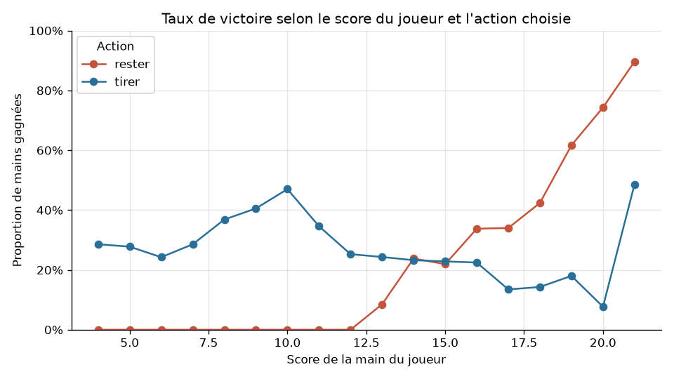
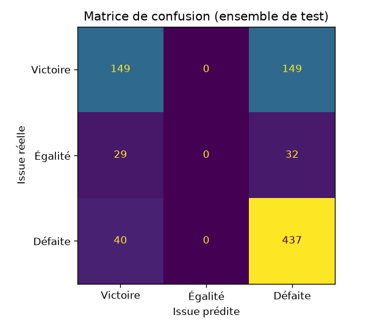

# Conseiller blackjack - INF1007, Projet 2


L'application répond à une question : Est-ce que c'est mieux de tirer ou de rester ?
L'utilisateur pose ses cartes sur une table (ou tape sa situation). Le modèle estime ensuite les chances de
victoire, de défaite et d'égalité pour chacune des deux actions, puis conseille la plus favorable.

> Exercice pédagogique : ce n'est pas une aide à la décision pour des jeux d'argent.

Équipe : William Proulx (données, modèle, couche application), Mehdi Rachidi (interface).

## Installation et lancement

Python 3.12 est requis.

```bash
pip install -r requirements.txt
python entrainer.py          # (facultatif) régénère le modèle et les figures
streamlit run main.py        # ouvre l'application dans le navigateur (ou : python main.py)
```

Le modèle entraîné est déjà dans `modeles/` : l'application ne réentraîne rien.
`python entrainer.py` refait toute la démarche (exploration, nettoyage, comparaison des deux modèles,
figures, sauvegarde) et redonne exactement le même modèle (seed 42).

Tests :

```bash
python -m pytest
coverage run -m pytest && coverage report --include="src/*"
```

## Données

**Provenance** : la sauvegarde (`donnees/agent_v3_model.bin`) de mon agent de blackjack entraîné par
apprentissage par renforcement lors d'un cours collégial :
https://github.com/Wproulx09/blackjack-agent. Pour chaque situation de jeu et chaque action, elle
contient le nombre de victoires, de défaites et d'égalités obtenues par l'agent contre le serveur.

**Licence** : données produites par moi, publiées sous licence
[CC0 1.0](https://creativecommons.org/publicdomain/zero/1.0/) (domaine public).

**Conversion** : le script décompresse le fichier et écrit une ligne par décision dans
`donnees/blackjack_decisions.csv` (4 181 lignes).

```bash
python outils/extraire_donnees_agent.py
```

**Colonnes**

| Colonne | Description |
|---|---|
| `score_joueur` | Valeur de la main du joueur |
| `score_croupier` | Carte visible du croupier (As = 11) |
| `as_souple` | oui / non : la main a un As compté 11 |
| `nb_dix` | Cartes de valeur 10 visibles |
| `cartes_utiles` | Cartes restantes qui aideraient la main (`very_few` à `many`) |
| `cartes_bust` | Cartes restantes qui feraient dépasser 21 (`low_risk` à `high_risk`) |
| `action` | tirer / rester |
| **`resultat`** | **Cible** : victoire / defaite / egalite |

**Exploration et nettoyage** (`python entrainer.py`) :

- Aucune valeur manquante. 3 lignes retirées : un score du joueur plus grand que 21 (déjà perdue).
- La cible est déséquilibrée : 57 % de défaites, 36 % de victoires et 7 % d'égalités.
- `cartes_utiles` et `cartes_bust` ne sont pas utilisées : un joueur ne peut pas les connaître sans
  compter les cartes.



Le graphique montre pourquoi la décision dépend du score : jusqu'à 12, rester ne gagne presque
jamais. À partir de 17, rester est meilleur que tirer. Entre 13 et 16, l'écart se resserre. Vers 14-15 les deux actions sont équivalentes : 
c'est la zone où un conseil est le plus utile et difficile.

## Modèle

- **Problème** : classification en 3 classes (victoire, défaite, égalité).
- **Variables** : `score_joueur`, `score_croupier`, `nb_dix` (numériques) ; `as_souple`, `action`
  (catégorielles).
- **Séparation** : 80 % entraînement (3 342 lignes) et 20 % test (836 lignes), seed 42.
- **Métriques** : F1 macro, parce que les classes sont déséquilibrées, et log loss, parce que
  l'application affiche des probabilités et qu'elles doivent être fiables. Le modèle est choisi sur la
  log loss (plus petite = meilleure).
- **Référence** : `DummyClassifier`, qui prédit toujours « défaite » avec la fréquence de chaque classe
  comme probabilités.

**Résultats sur l'ensemble de test**

| Modèle | F1 macro | Exactitude | Log loss |
|---|---|---|---|
| Référence (toujours « défaite ») | 0,242 | 57,1 % | 0,879 |
| Régression logistique | 0,446 | 66,9 % | 0,819 |
| **Forêt aléatoire (retenue)** | **0,459** | **70,1 %** | **0,716** |

La forêt aléatoire bat la référence sur les trois mesures. Elle est retenue parce que l'effet du score
n'est pas linéaire (rester à 16 est mauvais, rester à 20 est excellent), ce qu'une forêt capte mieux
qu'une régression logistique.



**Limites**

- **Le modèle ne prédit jamais « égalité »** : elle est rare (7 %) et n'est jamais l'issue la plus
  probable. Il confond aussi souvent victoire et défaite (149 victoires prédites comme des défaites).
  C'était attendu : au blackjack la même situation peut finir de trois façons selon les cartes suivantes. 
  C'est pourquoi l'application s'appuie sur les probabilités et non sur l'issue **prédite par le modèle**.
- **Les données viennent d'un seul agent** : le modèle apprend ses parties, pas la stratégie optimale.
  `python outils/comparer_strategie_base.py` compare ses conseils à la stratégie de base du blackjack : accord sur 142 situations sur 160 (89 %), 83 %
  pondéré par la fréquence des mains. Il se trompe à 12 contre 4–6, à 13 contre 2–6, à 14 contre 5 et As, à 15 contre 7, 10 et As, et à 16 contre 7–As.
- **Décision serrée** : quand l'écart d'espérance entre tirer et rester est sous 0,10, l'application
  affiche un avertissement. Il signale 6 des 18 désaccords, dont les plus fréquents (15 et 16 contre
  10), mais aucun de ceux à 12–13.
- **`nb_dix`** : la validation accepte de 0 à 8, alors que les données d'entraînement ne dépassent
  pas 3. Au-delà, le modèle extrapole.

## Application

`streamlit run main.py` ouvre quatre onglets :

1. **Table de jeu** : glisser des cartes vers le croupier et vers sa main, puis « Que dit le
   modèle ? ».
2. **Saisie manuelle** : un champ par variable. Toutes les erreurs de saisie sont listées et rien
   n'est enregistré si la saisie est invalide.
3. **Le modèle** : les métriques comparées à la référence.
4. **Historique** : les prédictions précédentes (`historique/predictions.csv`).

Le résultat affiche le conseil, les probabilités en phrase claire, un avertissement si la décision
est serrée, et un graphique Matplotlib qui compare tirer et rester.

## Structure du code

```
main.py                     point d'entrée (streamlit run main.py)
entrainer.py                exploration, comparaison des modèles, figures, sauvegarde
outils/extraire_donnees_agent.py   .bin de l'agent → CSV
outils/comparer_strategie_base.py  conseils du modèle comparés à la stratégie de base
donnees/                    agent_v3_model.bin, blackjack_decisions.csv
modeles/                    modele.joblib + metadonnees.json
figures/                    exploration.png, matrice_confusion.png
src/
  donnees.py                JeuDeDonnees (charger, nettoyer, separer), Variable et ses enfants
  modele.py                 ModeleBase et ses enfants, métriques NumPy, sauvegarde et chargement
  application.py            Application (façade), Prediction, Historique
  cartes.py                 Carte, Main, Table : cartes posées → saisies du modèle
  graphiques.py             figures Matplotlib
  exceptions.py             DonneeInvalideError, FichierIntrouvableError
  interface/                application Streamlit et composant de la table de jeu
tests/                      tests pytest (données, variables, modèle, application, cartes,
                            graphiques, stratégie de base)
```

Les couches ne dépendent que de celles du dessous : `interface → application → modele → donnees`.
L'interface ne fait aucun calcul ; toute la logique passe par `Application` et se teste avec pytest.

**Programmation orientée objet**

- **Héritage** : `ModeleBase` (classe abstraite) → `ForetAleatoire`, `RegressionLogistique`. La classe
  parente fait l'entraînement, l'évaluation et la sauvegarde ; chaque enfant ne fournit que son
  estimateur. De même, `Variable` → `VariableNumerique`, `VariableCategorielle`.
- **Composition** : `Application` contient un modèle, un historique et des variables ; `Table`
  contient une `Main` et une carte de croupier.
- **Encapsulation** : attributs privés (`_modele`, `_df`…) exposés par des propriétés en lecture
  seule ; `Prediction` et `Carte` sont immuables (`dataclass(frozen=True)`).
- **Exceptions** : `DonneeInvalideError` et `FichierIntrouvableError` donnent des messages clairs à
  l'utilisateur au lieu d'un plantage.
- **NumPy** : l'exactitude et le F1 macro sont calculés de façon vectorisée (`exactitude`,
  `f1_macro`) et vérifiés contre scikit-learn dans les tests.

## Outil du chapitre 7

**Récursion** (outil principal) : `LecteurErlang.terme()` dans `outils/extraire_donnees_agent.py`.
Le `.bin` de l'agent est au format Erlang. Il est donc possible qu'une valeur en contienne d'autres (une map de
tuples qui contiennent des listes…), sans profondeur connue d'avance. `terme()` lit l'étiquette du
type ; pour un tuple, une liste ou une map, elle se rappelle sur chaque élément. Les cas de base sont
les nombres, les atomes et les chaînes. Une boucle simple ne suffirait pas pour suivre l'imbrication.

Autres outils du chapitre utilisés :

- **Décorateur** : `@chronometrer` (`src/modele.py`) mesure la durée d'entraînement sans modifier le
  code des modèles.
- **Générateur** : `lire_par_blocs()` (`src/donnees.py`) lit le CSV par blocs de 1 000 lignes avec
  `yield`.
- **Lambda** : tri de l'historique par date (`sorted(..., key=lambda ligne: ligne["date"])`).

## Tests et intégration continue

- 110 tests (pytest) : cas usuels, cas limites et cas d'erreur pour chaque module.
- **Couverture : 95 %** des modules de `src/` (hors interface). Les lignes non couvertes sont les
  blocs `if __name__ == "__main__"` et quelques méthodes secondaires de `cartes.py` (`__str__`,
  `reinitialiser`). L'interface Streamlit (`src/interface/`) n'est pas testée par pytest : elle
  ne contient pas de logique, et a été vérifiée à la main (cas normal, saisie invalide, graphique).
- La CI (`.github/workflows/tests.yml`) installe les dépendances et lance les tests avec la
  couverture à chaque push.

## Documentation consultée

- scikit-learn, `train_test_split` :
  https://scikit-learn.org/stable/modules/generated/sklearn.model_selection.train_test_split.html
- scikit-learn, `RandomForestClassifier` :
  https://scikit-learn.org/stable/modules/generated/sklearn.ensemble.RandomForestClassifier.html
- scikit-learn, `DummyClassifier` :
  https://scikit-learn.org/stable/modules/generated/sklearn.dummy.DummyClassifier.html
- scikit-learn, `log_loss` :
  https://scikit-learn.org/stable/modules/generated/sklearn.metrics.log_loss.html
- scikit-learn, sauvegarde de modèles (joblib) : https://scikit-learn.org/stable/model_persistence.html
- Streamlit, `st.pyplot` : https://docs.streamlit.io/develop/api-reference/charts/st.pyplot
- Matplotlib, `savefig` :
  https://matplotlib.org/stable/api/_as_gen/matplotlib.pyplot.savefig.html
- Format Erlang (External Term Format) : https://www.erlang.org/doc/apps/erts/erl_ext_dist.html

## Décisions et usage de l'IA

- Les choix du projet et leurs justifications sont dans [DECISIONS.md](DECISIONS.md).
- L'usage des outils d'IA (Claude, ChatGPT) est déclaré dans [Journal_IA.md](Journal_IA.md), avec
  les vérifications faites et les décisions prises.
